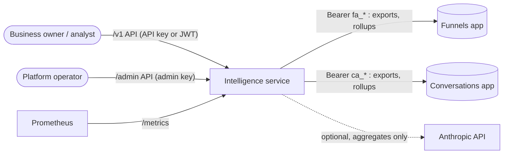
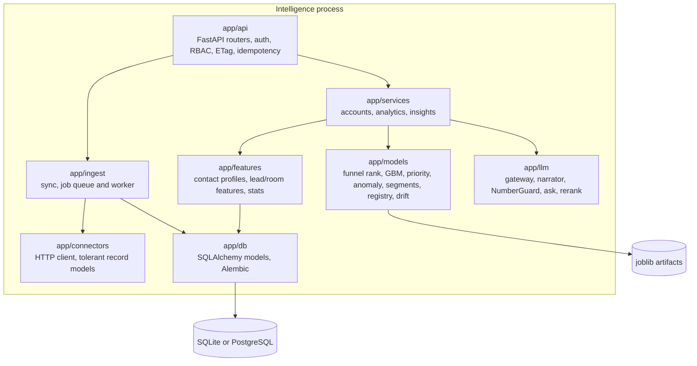
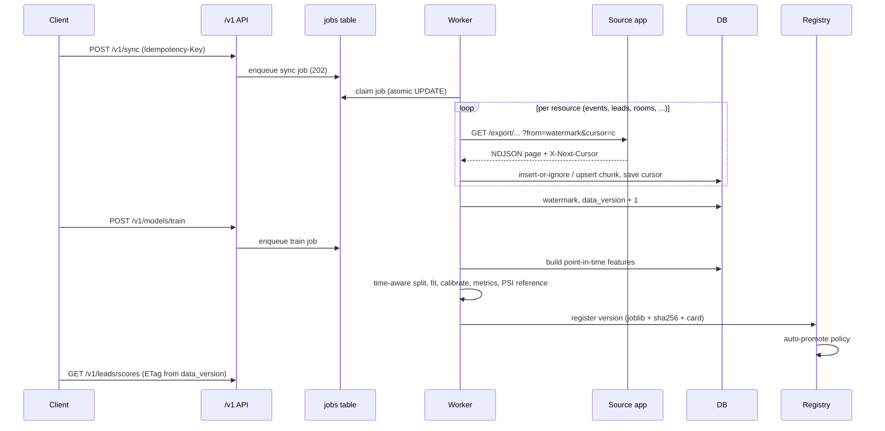
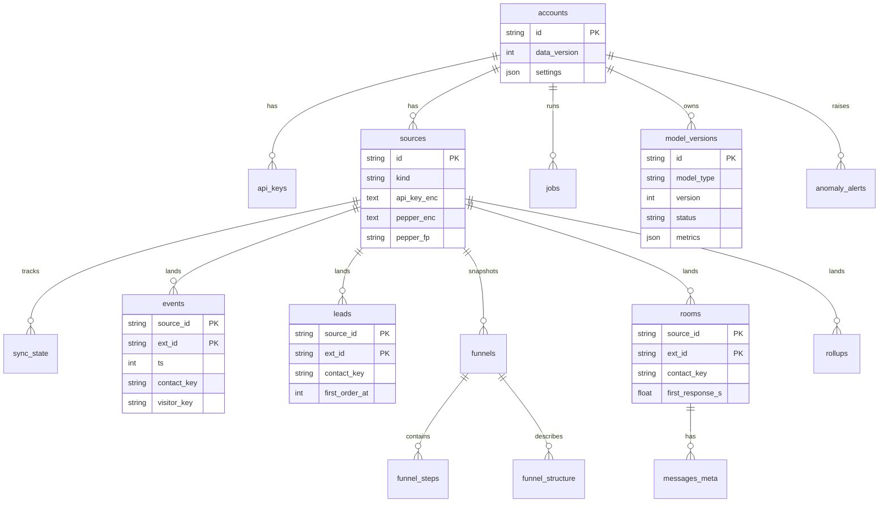
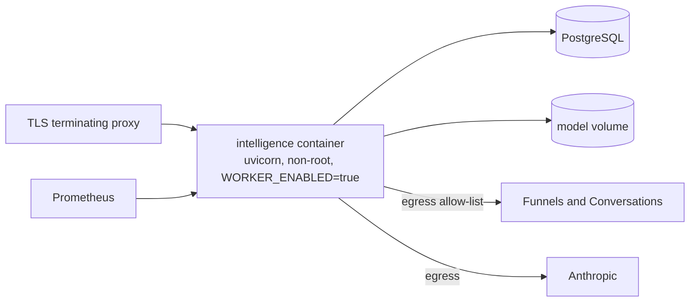

# Architecture

Intelligence is a standalone Python service. It reads two independent Node products (Funnels and Conversations)
only through the Analytics API contract, lands the data locally, trains small models per customer account, and
serves rankings and recommendations. The apps share no code with it; the contract is the only coupling.

## System context

## Containers and modules

`app/deps.py` is the composition root (`build_container`); nothing keeps module-level mutable state. The HTTP
client factory, LLM client, clock and DNS resolver are injected, which is how the tests run fully offline.

## Ingestion and training sequence

## Data model

`contact_key` is the join column between the Funnels and Conversations tables. There is no foreign key: it is an
HMAC value produced independently by each app from the shared pepper.

## Deployment

One instance runs the worker (the job queue is a DB table; a second worker is safe because claims are atomic
`UPDATE ... WHERE status='queued'`, but rate limiting is per instance). SQLite plus a local volume is enough for a
single node. The `JobQueue` protocol in `app/ingest/jobs.py` is the seam for Celery/Redis; that adapter is not built.
