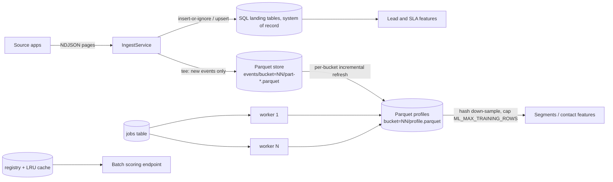

# Scaling

Target (from the platform scale targets, unchanged): **ingest and train on 100M+ events per account without loading it in memory
(chunked/columnar, bounded RSS); scale workers out horizontally; 5,000 scores/s per instance with batch endpoints; models cached and hot-swappable.**

Everything below is labelled **M** (measured here), **E** (extrapolated, with the assumption) or **D** (designed, not exercised).
Measurement machine: Apple arm64 laptop, 8 cores, 8 GB RAM, macOS 15.3, Python 3.13.9, polars 2.0, pyarrow 26, scikit-learn 1.7, shared with other
heavy jobs (load average 30-40 during runs), local SSD. SQLite only; no PostgreSQL was available.

## What was built

| Requirement | Implementation | Status |
|---|---|---|
| Chunked/columnar, Arrow/Parquet intermediates | `app/columnar/`: Parquet event store hash-bucketed by contact; Polars lazy scans; zstd | built, **M** |
| Streaming NDJSON ingestion | page-at-a-time client, chunked DB writes (`INGEST_CHUNK_ROWS`), resume cursors | built, **M** (2M rows, below) |
| Partitioned feature tables | `profiles/bucket=NN/` (profile + distinct-pair table + manifest per bucket) | built, **M** |
| Incremental feature refresh | manifest of processed part files per bucket; only new parts are read and merged; unchanged buckets are no-ops | built, **M** |
| No full retrain unless drift | `GET /v1/models/types/{type}/drift` (PSI) gates retrains; refresh of the feature layer is incremental; the GBM refit itself is full | partial: model refit is full by design |
| Worker scale-out behind a queue interface | `JobQueue` protocol, `DbJobQueue` (atomic claim, per-account cap, fair scheduling), `python -m app.worker --concurrency N`, `profiles` jobs fan a refresh out over bucket subsets (`POST /admin/accounts/{id}/refresh-profiles?shards=N`) | built; multi-process correctness tested; **multi-machine not measured**. Redis/Arq or Celery adapter: **not built** (D) |
| Batch scoring endpoint | `POST /v1/leads/score/batch` (features or contact keys, up to `BATCH_MAX_ROWS`) | built, **M** |
| Model caching with hot swap | `ModelRegistry.load_cached` (LRU of verified artifacts); the ACTIVE version id is resolved on every request, so promote/rollback swap the model live in every instance; feature frames cached per `data_version` | built, **M** (test) |
| Per-account resource budgets | concurrent jobs per account + fair scheduling, `ACCOUNT_MAX_EVENT_ROWS`, `ML_MAX_TRAINING_ROWS`, LLM call/token caps, request rate limits | built; visible in `/admin/accounts/{id}/usage` |
| Benchmark at 100M | `benchmarks/columnar_bench.py` | **M**: 100M and 300M events |

## Measured results

### Out-of-core store and profile refresh (`benchmarks/columnar_bench.py`, 1 process, 32 buckets, 1M-row chunks)
| Events | Contacts | Write (gen + Parquet) | Refresh all buckets | Peak RSS | Disk | Segments fit on capped sample |
|---|---|---|---|---|---|---|
| 5M (M) | 0.56M | 2.8 s | 0.5 s | 573 MB* | 45 MB | n/a |
| 40M (M) | 4.5M | 28.9 s | 4.3 s | 464 MB | 577 MB | n/a |
| **100M (M)** | 11.3M | 57 s (1.75M ev/s) | **11.3 s (8.9M ev/s)** | **638 MB** | 1.5 GB | 4.8 s on 491k contacts |
| **300M (M)** | 33.9M | 224 s (1.34M ev/s) | 51.6 s (5.8M ev/s) | **949 MB** | 4.7 GB | 3.2 s on 498k contacts |

\*the 5M row used 2M-row chunks (the first benchmark default); the others use 1M. About 430 MB of every peak is the benchmark's own chunk generator, not the library.
The 100M row is the headline: the account's complete event history was aggregated into per-contact profiles with a peak RSS under 650 MB on an 8 GB laptop, and a second refresh with nothing new takes 0.03 s.
Peak RSS grows with the **size of the largest bucket** (300M events / 32 buckets = 9.4M rows per bucket): to keep memory flat, set `COLUMNAR_BUCKETS` to about events / 3M (about 100 for 300M, 330 for 1B). The 949 MB at 300M is a measured consequence of leaving it at 32.
Data is synthetic (Zipf-ish contact popularity, 6 event types, 3 funnels x 4 steps), written directly into the store, not through HTTP.

**Bucket fan-out on one machine (M, 40M events):** refresh took 4.3 s with 1 process, 5.2 s with 2 and 5.4 s with 4. There is **no speed-up on one machine**: Polars already uses all cores inside a single process and the machine was saturated by other jobs. What the bucket design buys is (a) bounded memory per task and (b) independent units that other machines can take; cross-machine speed-up is **E** (see capacity model) and was not measured.

### SQL ingestion path (`benchmarks/ingest_bench.py`, SQLite, 1M-row pages through the real connector and upsert code)
2,000,000 events: 42.9 s (46,600 rows/s), peak RSS 107.5 MB vs 97.8 MB before (M). Memory is flat from 200k to 2M rows. SQLite stops being appropriate well before 100M rows (file size about 15 GB for 100M, single writer); this path is for small and medium accounts, or PostgreSQL (not measured).

### Inference (`benchmarks/scoring_bench.py`, GBM lead model, in-process and over the HTTP test client)
| Call | Scores/s (M) |
|---|---|
| `score_batch` with 100 feature rows | 6,700 (15 ms per call, dominated by fixed overhead) |
| 1,000 rows | 65,000 |
| 5,000 rows | 190,000 (26 ms per call) |
| 5,000 known contact keys | 141,000 |
| HTTP, 1,000 rows per request | 37,000 |
The target of 5,000 scores/s per instance is met with margin even for 100-row batches; single-row calls pay ~15 ms fixed cost (about 65/s), so clients should batch. A test asserts more than 5,000 scores/s.

### Training (`benchmarks/train_bench.py`)
500,000 rows x 11 features (the `ML_MAX_TRAINING_ROWS` cap): 16.5 s, peak RSS 495 MB (M). On the 2.8k-row synthetic lead set training takes about 1.6 s.

## Capacity model
Per-process constants from the measurements above (take them as order-of-magnitude on comparable hardware, not guarantees):

| Quantity | Formula | Constant |
|---|---|---|
| Parquet disk | `events x b` | b = 15.2-15.8 bytes/event (M, zstd level 3, 6 columns, includes the contact hash) |
| Profile refresh time | `events / r_refresh` | r_refresh = 5.8-8.9M events/s per process (M, one process using all cores) |
| Parquet append | `events / r_write` | r_write about 1.3-1.75M events/s including synthetic generation (M); real ingest is bounded by the source API, not this |
| Refresh RSS | `base + k x rows_in_largest_bucket` | base about 100-150 MB; k not isolated (E): keep rows per bucket at or below about 3M |
| Buckets | `ceil(events / 3M)` | rule of thumb derived from the 100M (3.1M/bucket, 638 MB) vs 300M (9.4M/bucket, 949 MB) runs |
| Sources of events | `source_rate_limit x page_size` | exports are limited to 10 requests/min per key by the contract: **1000-row pages give at most about 10,000 events/min per key = 14M events/day**, so backfilling 100M events through the HTTP contract takes about a week per key (E, from the contract's stated limit). The contract's export rate limit, not Intelligence, bounds ingest of history; use a bulk export/backfill outside the API for first loads. |
| Scores | `batch_rows / (15 ms + rows x 0.03 ms)` | M, see table |

Sizing guide (E, from the constants): 100M events per account: 1.5 GB Parquet, a refresh in about 15 s (minutes with a cold file cache and slower disks), 1 worker of 1-2 GB RAM with `COLUMNAR_BUCKETS=32`. 1B events: about 15 GB, `COLUMNAR_BUCKETS=330`, 150 s per full refresh per process; incremental refresh touches only new parts. 1,000 accounts at 10M events each: 150 GB, refreshed by a pool of workers bounded by `ACCOUNT_MAX_CONCURRENT_JOBS`.

Bottleneck ranking (observed or reasoned): 1. source export rate limits; 2. SQL landing database writes at tens of thousands of rows/s per SQLite writer; 3. lead-feature building from SQL (reads the visitors of all leads into pandas; **not** out-of-core, the main remaining limit for the lead model at 100M events); 4. GBM fit (16 s at the 500k cap); 5. Parquet refresh (seconds).

## Measured vs extrapolated
| Figure | Class | Note |
|---|---|---|
| 100M and 300M events aggregated, RSS 638 and 949 MB | M | single process, synthetic, laptop under load |
| 2M events through the real SQL ingest path, RSS flat at ~108 MB | M | SQLite |
| 5,000+ scores/s per instance | M | in-process and HTTP test client; not under concurrent load |
| Model hot swap and LRU cache behaviour | M | integration test, one process |
| Workers never double-claim a job; fair scheduling | M | 6 threads, 30 jobs; 3 asyncio runners, 12 jobs |
| Near-linear scale-out of refresh across machines | **not measured** | one machine only; single process already saturated it |
| Behaviour on PostgreSQL; real Redis queue | **not measured** | not available; no Redis adapter built |
| 1B-event numbers, bucket counts for them | E | from the constants above |
| Backfill duration through the contract's export limit | E | from the contract's 10 req/min |
| Real-data model quality at these volumes | **unknown** | all data synthetic |

## Tuning guide
- Raise `COLUMNAR_BUCKETS` with volume (see above); it is fixed for the life of a store, so choose generously (powers of two are convenient).
- Run `python -m app.worker --concurrency N` on separate processes/hosts with `WORKER_ENABLED=false` on API pods; keep `ACCOUNT_MAX_CONCURRENT_JOBS` at 1-2 so one tenant cannot occupy the pool.
- Fan a big refresh out with `POST /admin/accounts/{id}/refresh-profiles?shards=N`; compaction (`ParquetEventStore.compact`) merges small part files if the file count grows.
- Keep `ML_MAX_TRAINING_ROWS` at the default unless training time permits more; the cap keeps the most recent rows.
- Clients should batch scoring (at least 100 rows per call).

## Known limits
- The Parquet tee is not exactly-once at the watermark boundary second (see [ADR 0009](adr/0009-columnar-out-of-core-path.md)).
- Lead and SLA feature building still read SQL into pandas; only profile-level features (segments, volume statistics) are out-of-core.
- No cross-machine locking for Parquet buckets: do not refresh the same bucket from two workers at once (the `profiles` fan-out gives disjoint subsets).
- The job queue is a database table: fine for tens of workers, not for thousands.
